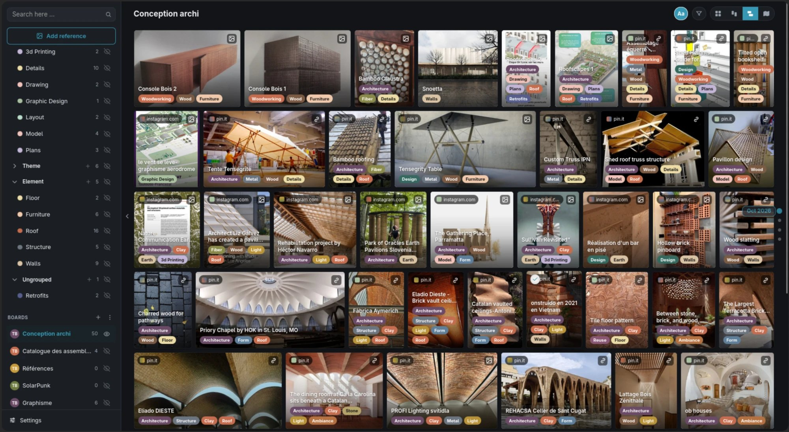

# Curio

[Curio on the Nextcloud App Store](https://apps.nextcloud.com/apps/curio)



A Nextcloud app for curating images, links, videos, PDFs and text notes into
visual boards, right inside Nextcloud.

Paste a link and Curio pulls in the picture, title and a saved snapshot. Upload
your own photos, drop in a PDF, or jot a note. Everything lands on a board as a
browsable tile. Organise boards with colored tags and folders, filter by type or
tag, and switch between square, vertical-masonry and map layouts. Share a board
with others using Nextcloud's own sharing and permissions.

Every reference is stored as a real file in your Nextcloud Files, in a folder you
choose on first launch. Drop a file into that folder and it appears on the board;
rename or remove it and the board follows.

## Requirements

- Nextcloud 31 to 35
- PHP 8.1+ (8.3+ on Nextcloud 35, which requires it)
- `imagick` recommended for PDF page previews

## Map tiles

The map layout uses [OpenFreeMap](https://openfreemap.org) vector basemaps
(OpenStreetMap data, light and dark styles), which need no API key. To use CARTO
basemaps instead, get a free key at https://carto.com/basemaps/apikey/, then
either paste it in Curio > Settings > "Map tiles (CARTO API key)" as an
administrator, or run:

```
occ config:app:set curio carto_api_key --value=YOUR_KEY
```

## Importing bookmarks

Settings > Import bookmarks adds references to a board from:

- a CSV: Curio's own export, Raindrop.io, Pocket, Instapaper, Diigo, or any spreadsheet with a `url`/`link` or `title`/`name` column (also read: `description`/`excerpt`, `note`/`notes`/`highlights`, `tags` separated by commas or `|`, `folder`/`collection`, `created`/`time_added`/`timestamp`, `cover`/`image`);
- a browser bookmarks file (`bookmarks.html`, the Netscape bookmark format that every browser and most bookmark services export); folders become tags;
- Pinboard JSON, or a plain list of links.

There is no standard CSV layout for bookmarks; the Netscape bookmark file is the de facto interchange format, so it is the safest choice when a service offers it.

## Install

Install from the [Nextcloud App Store](https://apps.nextcloud.com/apps/curio)
(Apps > Multimedia or Organization > Curio in your Nextcloud), or place this folder at
`custom_apps/curio` (or `apps/curio`) and enable it:

```
occ app:enable curio
```

## Build

The frontend bundle in `js/` is prebuilt. To rebuild it after changing `src/`:

```
npm install
npm run build
```

## Android app

The `android/` folder holds Curio for Android: the full Curio app on a phone,
plus clipping from the share menu of Instagram, Pinterest, TikTok or any app.
Download the latest APK from
[Releases](https://github.com/Acknar/Curio/releases/latest/download/curio-android.apk);
Curio's first-run tour (replayable from Settings > Help) links to it with a QR
code and install steps. See [android/README.md](android/README.md). It is not part of the Nextcloud app;
leave `android/`, `.github/` and `node_modules/` out when packaging the app.

## License

Curio is licensed under the GNU Affero General Public License v3.0 or later.
See [COPYING](COPYING).
